# Awesome Cloud eDiscovery & Legal Hold Management ⚖️ ☁️

<div align="center">

<p align="center">
  
</p>

# 🏛️ Awesome Cloud eDiscovery & Legal Hold Management

**A curated directory of enterprise SaaS platforms, open-source eDiscovery engines, legal hold automation systems, and digital forensics tools.**

<p align="center">
  <a href="https://github.com/ishandutta2007/Awesome-Awesome-Awesome"></a>
  <a href="https://discord.gg/jc4xtF58Ve"></a>
  <a href="https://github.com/ishandutta2007/Awesome-Cloud-Ediscovery-Legal-Hold-Management/stargazers"></a>
  <a href="https://github.com/ishandutta2007/Awesome-Cloud-Ediscovery-Legal-Hold-Management/network/members"></a>
  <a href="https://github.com/ishandutta2007/Awesome-Cloud-Ediscovery-Legal-Hold-Management/issues"></a>
  <a href="https://github.com/ishandutta2007/Awesome-Cloud-Ediscovery-Legal-Hold-Management/blob/main/LICENSE"></a>
  <a href="https://github.com/ishandutta2007"></a>
</p>

<p align="center">
  <em>Defensible Preservation • Custodian Tracking • Early Case Assessment • ESI Ingestion • GenAI Document Review • Digital Forensics</em>
</p>

</div>

---

## 📖 Overview

This repository tracks notable **SaaS platforms** and **open-source software** across the **Cloud eDiscovery & Legal Hold Management** ecosystem. These solutions empower corporate legal departments, law firms, IT administrators, and compliance officers to defensively identify, preserve, collect, and review electronically stored information (ESI) for civil litigation, internal investigations, FOIA requests, and regulatory audits.

Whether automating custodian acknowledgment notifications, enforcing in-place cloud holds across Microsoft 365, Google Workspace, and Slack, or architecting self-hosted, vendor-neutral preservation pipelines without per-GB billing penalties, this guide delivers market-tested options.

---

## 📑 Table of Contents

- [📈 Sector Overview & Market Dynamics](#-sector-overview--market-dynamics)
- [🏢 SaaS & Hosted Platforms](#-saas--hosted-platforms)
- [💻 Open-Source GitHub Projects](#-open-source-github-projects)
- [🛠️ Architecture: Custom Preservation Pipelines](#️-architecture-custom-preservation-pipelines)
- [🤝 How to Contribute](#-how-to-contribute)
- [💖 Support](#-support)
- [📊 Star History](#-star-history)
- [⚠️ Disclaimer](#️-disclaimer)

---

## 📈 Sector Overview & Market Dynamics

The global eDiscovery and legal hold software sector is valued between **$15B and $21B** and is projected to expand toward **$31B to $46B by the early 2030s**, compounding at an **8%–11% CAGR**. Growth is heavily accelerated by explosive growth in cloud messaging platforms (Slack, Teams, Zoom), complex regulatory data privacy regimes (GDPR, CCPA/CPRA, HIPAA), and the adoption of Generative AI and Technology-Assisted Review (TAR) to compress manual review cycles.

The competitive landscape is **moderately fragmented and actively consolidating**: enterprise ecosystem leaders (**Microsoft**, **Relativity**, **OpenText**) anchor large corporate and government deployments, while agile legaltech innovators (**Everlaw**, **DISCO**, **Exterro**, **Reveal/Logikcull**) aggressively compete on AI review efficiency and cloud-native workflows. High-volume private equity rollups continue to unify point solutions into integrated Legal GRC (Governance, Risk, and Compliance) suites.

---

## 🏢 SaaS & Hosted Platforms

*Enterprise-grade cloud discovery and automated custodian hold platforms, sorted descending by organization size (market capitalization, private valuation, or annual revenue).*

| Product | Scale (Valuation / Market Cap / Revenue) | Description | Pricing (Starting Tier) | Free Tier / Trial Limits |
|---------|------------------------------------------|-------------|-------------------------|--------------------------|
| **[Microsoft Purview eDiscovery](https://learn.microsoft.com/en-us/purview/)** | ~$4.0T Market Cap (Public: MSFT) | Native eDiscovery and legal hold within Microsoft 365. Standard cases support up to 1,000 mailboxes on hold; Premium adds advanced analytics, automated custodian notifications, and deep Teams/SharePoint indexing. | Starts at **$36.00/user/month** (Microsoft 365 E3 for Standard eDiscovery); eDiscovery Premium add-on starts at **$12.00/user/month** over E3, or included in Microsoft 365 E5 at **$60.00/user/month** | **30-day free trial** of Microsoft 365 E3/E5 with up to 25 user licenses; no permanent free tier |
| **[OpenText Axcelerate](https://www.opentext.com/)** | ~$6.1B Market Cap (Public: OTEX) | Enterprise eDiscovery and investigations platform with AI-assisted review, analytics, and production. Part of OpenText's broader information management suite. | Custom enterprise subscription; starting tiers generally structure around **$10 to $20/GB/month** for active hosting, or G-Cloud public framework modules starting from **£230/user/year** | No permanent free tier; **custom proof-of-concept (PoC) / sandbox trial** available on request via sales team (typically 14–30 days under NDA) |
| **[Relativity](https://www.relativity.com/)** | ~$3.6B Valuation (Private equity backed) | Industry-standard eDiscovery platform (RelativityOne cloud) with comprehensive processing, review, analytics, and production capabilities. Extensive REST APIs for legal hold management and case administration. | Pay-As-You-Go starting tier begins at **$11.00 to $15.00/GB/month** for active data hosting; long-term Flex Commit volume tiers scale down to **$4.00 to $8.00/GB/month** | No permanent free tier; **custom test sandbox / demo trial** available upon request via sales and authorized hosting partners |
| **[Druva eDiscovery and Legal Hold](https://www.druva.com/)** | ~$2.0B Valuation (Private equity backed) | Cloud-native eDiscovery and legal hold within Druva's cyber resilience platform. Enables legal teams to identify, preserve, and export custodian data across endpoints, SaaS apps, and cloud workloads. | Starts at **$8.00/user/month** for entry SaaS/endpoint backup & discovery tiers; enterprise legal hold & compliance editions scale up to **$10–$16/user/month** | **30-day free trial** with up to 1 TB of storage and endpoint protection for evaluation; no permanent free tier |
| **[Everlaw](https://www.everlaw.com/)** | ~$2.0B Valuation (Private venture backed) | Cloud-based eDiscovery and litigation platform with advanced analytics, predictive coding, and collaborative review. Used by law firms, corporations, and government agencies for complex matters. | Active data hosting starting at **$18.00 to $35.00/GB/month** with **unlimited user reviewer seats** included; processing and native ingestion bundled | No permanent free tier; **guided evaluation trial / matter pilot** available on request via sales team (typically 14 to 30 days) |
| **[Exterro](https://www.exterro.com/)** | ~$1.0B+ Valuation (Unicorn / Private PE backed) | Enterprise legal governance, risk, and compliance platform with eDiscovery, legal hold, and forensic collection (FTK). Features automated reminder and escalation rules for custodian acknowledgments. | Modular enterprise licensing; starter legal hold & eDiscovery data packages start from baseline commitments (typically starting at **$10,000/year** or standalone FTK forensic seats starting from **$2,500/seat/year**) | No permanent free tier; **guided pilot / product trial** offered upon qualification via sales (typically 14–30 days) |
| **[Logikcull](https://www.logikcull.com/)** | ~$1.0B+ (Part of Reveal via $1B+ acquisition) | Self-service cloud eDiscovery platform for small and mid-sized legal teams. Supports upload, processing, search, tagging, and production with a focus on simplicity and speed. | Pay-As-You-Go starting at **$40.00/GB/month** with a 10 GB monthly minimum ($400/month) including unlimited users; annual subscription tiers offer lower per-GB commitments | **Free test tier up to 10 GB** of user data with sample matter exploration (no strict day cutoff, requires payment setup to export/scale); no permanent full free tier |
| **[Onna](https://www.onna.com/)** | ~$100M+ Scale (Acquired by Reveal in 2024; $50M+ total raised) | Knowledge integration and eDiscovery platform with legal hold and preservation API. Supports JSON Logic query-based custodian targeting and lifecycle management across collaboration tools. | Data volume-based starting at a **1 TB baseline tier** (typically priced from **$15,000 to $25,000/year**) with **unlimited users and connectors** included | No permanent free tier; **14-day to 30-day evaluation sandbox trial** available on request via enterprise sales |
| **[DISCO](https://www.csdisco.com/)** | ~$350M Market Cap (Public: LAW) | AI-powered legal technology platform with eDiscovery, legal hold, and case management. Features one-click preserve-in-place across M365, Google Vault, Slack, and other sources with automated custodian workflows. | All-inclusive per-GB pricing starting at approximately **$20.00 to $40.00/GB/month** for processed data, including Cecilia AI and unlimited user seats | No standard public free tier (custom 14-day sales demo/pilot available); provides a **permanent Free Pro Bono Tier up to 50 GB** for qualifying pro bono litigation |
| **[Casepoint](https://www.casepoint.com/)** | ~$100M+ Annual Revenue (Privately held) | Unified eDiscovery platform with legal hold module featuring automated communications, notifications, and custodian management. Includes collection, processing, and review capabilities. | All-inclusive hosting model starting at approximately **$12.00 to $25.00/GB/month** with **unlimited user seats and reviewers**, or modular legal hold packages from **$5,000/year** | No permanent free tier; **custom 14-day to 30-day pilot / sandbox trial** provided upon request for qualified corporate or law firm matters |
| **[Nextpoint](https://www.nextpoint.com/)** | ~$20M–$40M Scale (Privately held mid-market) | Cloud-based eDiscovery and trial preparation platform with legal hold, processing, review, and production. Positioned for litigation teams seeking an integrated workflow. | User-seat flat pricing starting at **$299.00/user/month** with **unlimited data storage and processing** (no per-GB hosting charges) | No self-serve free trial or permanent free tier; **live guided demo and pilot environment** available on request via sales |

---

## 💻 Open-Source GitHub Projects

*Open-source legaltech tools, digital forensics frameworks, email archival solutions, and document review systems. Ranked in **descending order by GitHub Stars_Count**.*

| Project | Stars_Badge | Focus Area | Description |
|:---|:---:|:---:|:---|
| **[paperless-ngx](https://github.com/paperless-ngx/paperless-ngx)** | [](https://github.com/paperless-ngx/paperless-ngx/stargazers) | Document Archiving & OCR | Community-driven document management system with OCR, full-text indexing, metadata tagging, and REST APIs. Widely adopted for indexing evidentiary paper trails and digital matter files. |
| **[google/timesketch](https://github.com/google/timesketch)** | [](https://github.com/google/timesketch/stargazers) | Collaborative Timeline Analysis | Open-source collaborative forensic timeline analysis tool built by Google. Uses Elasticsearch/OpenSearch to index chronological ESI evidence, audit trails, and custodian activity logs. |
| **[sleuthkit/autopsy](https://github.com/sleuthkit/autopsy)** | [](https://github.com/sleuthkit/autopsy/stargazers) | Forensic Collection & ESI Analysis | Premier open-source digital forensics platform used by law enforcement, corporate incident response teams, and military examiners to extract, search, and analyze hard drives and mobile ESI. |
| **[sleuthkit/sleuthkit](https://github.com/sleuthkit/sleuthkit)** | [](https://github.com/sleuthkit/sleuthkit/stargazers) | File System Forensics Library | Core C/C++ library and collection of command-line tools that powers Autopsy and digital investigations, enabling forensically defensible inspection of volume and file system data. |
| **[sepinf-inc/IPED](https://github.com/sepinf-inc/IPED)** | [](https://github.com/sepinf-inc/IPED/stargazers) | Forensic eDiscovery & Processing | High-performance digital forensics and eDiscovery processing tool developed by the Brazilian Federal Police. Features OCR, geolocation, keyword indexing, and multi-threaded ESI parsing. |
| **[log2timeline/plaso](https://github.com/log2timeline/plaso)** | [](https://github.com/log2timeline/plaso/stargazers) | Super-Timeline Generation | Python-based engine used to extract timestamps from multiple evidentiary log files and file systems, creating cohesive super-timelines for litigated data investigations. |
| **[mayan-edms/Mayan-EDMS](https://github.com/mayan-edms/Mayan-EDMS)** | [](https://github.com/mayan-edms/Mayan-EDMS/stargazers) | Document Management & Workflow | Free, open-source Electronic Document Management System (EDMS) with cryptographic document signing, advanced workflow automations, and full-text search capabilities. |
| **[google/turbinia](https://github.com/google/turbinia)** | [](https://github.com/google/turbinia/stargazers) | Cloud Forensic Automation | Google's open-source framework for automating cloud-based digital forensic processing. Automates disk carving, Plaso processing, and evidence triage in GCP and AWS cloud environments. |
| **[openpreserve/jhove](https://github.com/openpreserve/jhove)** | [](https://github.com/openpreserve/jhove/stargazers) | ESI Format Validation & Characterization | Extensible digital preservation engine that validates file format conformance and characterization for electronic record preservation and courtroom compliance. |
| **[shmsoft/FreeEed](https://github.com/shmsoft/freeeed)** | [](https://github.com/shmsoft/freeeed/stargazers) | Dedicated Open-Source eDiscovery | Purpose-built open-source eDiscovery engine supporting OCR, metadata extraction, PST/email parsing, and AI-assisted document review across 1,400+ file formats. |
| **[FreeDiscovery/FreeDiscovery](https://github.com/FreeDiscovery/FreeDiscovery)** | [](https://github.com/FreeDiscovery/FreeDiscovery/stargazers) | Machine Learning & Predictive Coding | Open-source eDiscovery REST API and Python toolkit built on scikit-learn for semantic search, email threading, duplicate clustering, and Technology-Assisted Review (TAR). |
| **[noamrazbuilds/legal-hold-manager](https://github.com/noamrazbuilds/legal-hold-manager)** | [](https://github.com/noamrazbuilds/legal-hold-manager/stargazers) | Legal Hold Notice Automation | Python-based litigation hold management system to issue, track, remind, and document custodian hold notices with audit trails for defensible corporate legal operations. |
| **[nimdassdev/OpenArchiver](https://github.com/nimdassdev/OpenArchiver)** | [](https://github.com/nimdassdev/OpenArchiver/stargazers) | Self-Hosted Email Archiving | Modern email archiving stack featuring universal ingestion (Google Workspace, M365, IMAP, PST), full-text Meilisearch indexing, deduplication, and S3 storage. |
| **[LioRael/lenso-legal-hold-plugin](https://github.com/LioRael/lenso-legal-hold-plugin)** | [](https://github.com/LioRael/lenso-legal-hold-plugin/stargazers) | Database Retention Guard | PostgreSQL-backed legal hold backend providing preservation scoping, release rules, idempotency receipts, and guard-decision evidence logs. |

---

## 🛠️ Architecture: Custom Preservation Pipelines

For teams looking to construct a defensible, self-hosted preservation stack without vendor lock-in or recurring cloud gigabyte surcharges:

```text
[ Custodians / ESI Sources ]
      │ (Google Workspace, M365, Slack, Endpoints)
      ▼
┌────────────────────────┐
│  Ingestion & Archival   │ ──► OpenArchiver / Lenso Legal Hold Plugin
└────────────────────────┘
      │
      ▼
┌────────────────────────┐
│ Forensic Extraction    │ ──► IPED / Autopsy / The Sleuth Kit / Turbinia
└────────────────────────┘
      │
      ▼
┌────────────────────────┐
│ Processing & Analytics │ ──► FreeEed / FreeDiscovery (scikit-learn TAR) / Plaso
└────────────────────────┘
      │
      ▼
┌────────────────────────┐
│ Timeline & Review Set  │ ──► Google Timesketch / Mayan EDMS / Paperless-ngx
└────────────────────────┘
```

- **Universal Email & SaaS Archiving**: Deploy **OpenArchiver** or **Lenso Plugin** for multi-tenant data ingestion and retention guard rails.
- **Forensic Extraction**: Use **IPED** and **The Sleuth Kit** for cryptographically verified bitstream disk imaging and container unpacking.
- **Processing & TAR**: Leverage **FreeEed** for batch OCR and file conversion, combined with **FreeDiscovery** for semantic clustering, near-duplicate detection, and predictive coding.
- **Timeline Discovery**: Pipe chronological events into **Google Timesketch** for deep cross-custodian investigative analysis.

---

## 🤝 How to Contribute

Contributions are welcome! Help build the definitive open resource for eDiscovery practitioners:

1. 🍴 Fork this repository.
2. 🌿 Create your feature branch (`git checkout -b feature/new-discovery-tool`).
3. 📝 Add or update entries in `README.md` (keep descriptions objective and include official links).
4. 🚀 Commit your changes (`git commit -m "Add new eDiscovery platform"`).
5. 📤 Push to the branch (`git push origin feature/new-discovery-tool`).
6. 🎯 Open a Pull Request.

---

## 💖 Support

Thank you for exploring and utilizing this resource! If this repository helped streamline your legal ops evaluations, case preparation, or data preservation architecture:

- ⭐ **Star this repository** to boost visibility for the legaltech community.
- 🔀 **Fork and share** with colleagues in legal ops, IT governance, and forensic practice.
- ☕ **Support continuous maintenance**: Buy a coffee or become a sponsor on the [GitHub Sponsor Dashboard](https://github.com/sponsors/ishandutta2007).

---

## 📊 Star History

[](https://www.star-history.com/#ishandutta2007/Awesome-Cloud-Ediscovery-Legal-Hold-Management&type=date&legend=top-left)

---

## ⚠️ Disclaimer

- This repository is a community-curated educational index—not an endorsement or formal legal opinion.
- eDiscovery, litigation hold, and digital forensics procedures govern sensitive, privileged work product. Always consult certified forensic specialists and legal counsel to verify defensibility under applicable federal and local rules of civil procedure.
